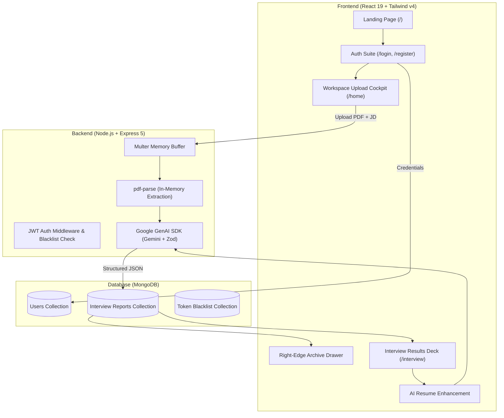

# 🚀 SkillGapStudio — AI Resume Analyzer, Optimizer & Interview Prep Engine

> An end-to-end, full-stack MERN application powered by Google Gemini that benchmarks candidate resumes against targeted job descriptions, exposes critical competency discrepancies, generates dynamic interview scenarios, crafts a day-by-day preparation roadmap, and helps candidates enhance their resumes for specific job opportunities.

---

## 📌 Executive Summary

Most traditional Application Tracking Systems (ATS) and online resume checkers rely on **dumb keyword density algorithms**—if a candidate uses the word *"PostgreSQL"* instead of *"relational database"*, they get rejected. Furthermore, standard scanners leave candidates completely in the dark regarding **how to actually prepare** for the technical interview.

**SkillGapStudio** eliminates this guesswork:

1. **Stateless PDF Ingestion**: Extracts verified technologies, experience, and impact metrics directly from uploaded resume PDFs.
2. **Semantic Competency Delta Mapping**: Leverages Google Gemini with structured Zod output validation to calculate true architectural alignment.
3. **Dynamic Screening Simulator**: Generates evaluator-grade technical and behavioral interview questions tailored specifically around detected gaps.
4. **Actionable 7-Day Roadmap**: Formulates a daily mastery plan with interactive module tracking so candidates can systematically bridge their gaps before interview day.
5. **AI-Powered Resume Enhancement**: Helps candidates improve and tailor their resume content according to the target job description, making relevant skills and experience clearer to recruiters.

---

## 🛠️ Complete Tech Stack

### Frontend (Client-Side)
* **Framework**: React 19 (Vite)
* **Routing**: React Router v7
* **Styling**: Tailwind CSS v4 (Obsidian Luxury Dark Palette)
* **Icons**: Lucide React
* **State Management**: React Context API (`AuthContext`, `InterviewContext`) + Custom Hooks (`useAuth`, `useInterview`)
* **Interactive Canvas**: Native HTML5 Canvas stardust constellation engine with real-time mouse gravitational tethering (60 FPS)

### Backend (Server-Side)
* **Runtime**: Node.js
* **Framework**: Express.js (v5)
* **Database**: MongoDB with Mongoose ODM
* **AI & LLM Integration**: Official Google Gen AI SDK (`@google/genai`) powered by `gemini-3.6-flash`
* **Schema Validation & Structured Output**: Zod (`zod-to-json-schema`)
* **File Processing**: Multer (In-memory buffer storage) & `pdf-parse`
* **Authentication & Security**: JSON Web Tokens (JWT) in HTTP-only cookies, `bcryptjs` password hashing, token blacklist database model

---

## 🎯 Key Application Features

### 1. 🌌 Luxury Animated Landing Page (`/`)
* **60 FPS Interactive Background**: Stardust constellation canvas with cursor-reactive particle physics.
* **Live Sandbox Flight Deck**: Test the platform with one click across pre-configured engineering presets (*Senior Full-Stack*, *Applied AI Architect*, *Cloud SRE*).
* **Architectural Comparison**: Clear side-by-side breakdown contrasting traditional keyword counters against semantic gap intelligence.

### 2. 🔐 Obsidian Authentication Suite (`/login` & `/register`)
* **Career Stage Selector**: Custom 3-way segmented control (*Student*, *Fresher*, *Working Professional*) matching backend Mongoose schemas.
* **Strict Client & Server Validation**:
  - Contact number restricted strictly to 10 digits with live counter.
  - Age boundaries strictly enforced between 18 and 80 years.
* **Cryptographic Vault Password Visualizer**: Dynamic 4-tier security meter tracking casing, numbers, symbols, and length in real time.
* **Instant Auto-Fill**: One-click demo credentials for zero-friction evaluation.

### 3. 💼 Personalized Workspace Cockpit (`/home`)
* **Personalized User Greeting**: Tailored greeting displaying user track badges (*Student Track*, *Fresher Track*, *Working Track*).
* **Drag-and-Drop Resume Ingestion**: PDF dropzone with file size formatting, validation, and removal controls.
* **Right-Edge Cursor-Activated Archive Drawer**: Moving your mouse to the right edge of the screen smoothly slides out the analysis history drawer, complete with a pin/unpin lock.
* **Zero Fake Data**: The archive strictly pulls the user's real MongoDB evaluations.
* **Secure Logout**: Revokes the JWT token, blacklists the session, and redirects to `/login`.

### 4. 📊 High-Octane Interview Deck (`/interview` or `/home/interview`)
* **Zero Tacky Gradients**: Minimalist obsidian matte finish with high-contrast typography and subtle borders.
* **Candidate Fit Index**: SVG circular gauge showing exact alignment percentage (`matchScore`) and qualitative tier.
* **Skill Gaps Matrix**: Filterable by severity (*High*, *Medium*, *Low*) with clear technical reasoning for each gap.
* **Interactive Self-Testing Accordions**: Candidates read scenario questions and interviewer intent, with a click-to-reveal toggle for structured model answers.
* **Curated Day-by-Day Roadmap**: Interactive checklist where candidates can mark study modules complete (`X / Y completed`).
* **Utility Features**: One-click brief copying to clipboard and clean print/export PDF formatting.

### 5. ✨ AI-Powered Resume Enhancement
* **Job-Specific Resume Tailoring**: Enhances the candidate's resume according to the job description used for the analysis.
* **Relevant Content Improvement**: Helps refine resume content so that relevant skills, projects, and experience are presented more clearly for the target role.
* **Better Job Description Alignment**: Aligns the wording of the resume with relevant requirements and terminology from the job description.
* **Candidate-Focused Enhancement**: Uses the candidate's existing resume information as the basis for improvements. Candidates should review the generated content to ensure that all details remain accurate.
* **Improved Application Readiness**: Helps candidates present their qualifications more effectively for a specific opportunity. Resume enhancement cannot guarantee shortlisting or selection.

---

## 🏛️ System Architecture



---

## 📂 Project Directory Structure

```text
PROJECT6_RESUMEBUILDER/
├── backend/
│   ├── src/
│   │   ├── config/
│   │   │   └── database.js          # MongoDB connection handler
│   │   ├── controller/
│   │   │   ├── authController.js     # Register, Login, Logout, getMe
│   │   │   └── interview.controller.js # PDF parsing, Gemini call, report CRUD
│   │   ├── middleware/
│   │   │   ├── authMiddleware.js     # JWT cookie extraction & blacklist check
│   │   │   └── file.middleware.js    # Multer configuration with memoryStorage
│   │   ├── model/
│   │   │   ├── blacklist.model.js    # Expired/logged out token storage
│   │   │   ├── interviewReport.model.js # Structured report Mongoose schema
│   │   │   └── user.model.js         # User model with age/profession enums
│   │   ├── routes/
│   │   │   ├── auth.routes.js        # /api/auth/* endpoints
│   │   │   └── interview.routes.js   # /api/ai/* endpoints
│   │   ├── services/
│   │   │   └── ai.service.js         # Google Gemini integration with Zod schema
│   │   ├── validate/
│   │   │   └── authValidation.js     # express-validator rules
│   │   └── app.js                    # Express app configuration & CORS
│   ├── server.js                     # Server entry point (port 3000)
│   └── package.json
│
└── frontend/
    └── ResumeBuilderFrontend/
        ├── src/
        │   ├── features/
        │   │   ├── auth/
        │   │   │   ├── components/
        │   │   │   │   ├── Loading.jsx   # AIAnalysisLoader component
        │   │   │   │   └── Protected.jsx # Route authentication guard
        │   │   │   ├── hooks/
        │   │   │   │   └── useAuth.js    # Auth hook layer
        │   │   │   ├── pages/
        │   │   │   │   ├── Login.jsx     # Luxury obsidian sign-in page
        │   │   │   │   └── Register.jsx  # Interactive registration with vault bar
        │   │   │   ├── services/
        │   │   │   │   └── auth.services.js # Axios instance for auth API
        │   │   │   └── state/
        │   │   │       └── auth.context.jsx # Auth state provider
        │   │   └── interview/
        │   │       ├── hooks/
        │   │       │   └── useInterview.js # Report generation & archive hooks
        │   │       ├── pages/
        │   │       │   ├── Home.jsx      # Upload cockpit & hover archive
        │   │       │   └── Interview.jsx # Results deck with self-testing accordions
        │   │       ├── services/
        │   │       │   └── interview.js  # Multipart/form-data upload client
        │   │       └── interview.context.jsx # Interview state provider
        │   ├── LandingPage.jsx           # Animated interactive landing page
        │   ├── App.jsx                   # Context providers & router wrapper
        │   ├── app.routes.jsx            # Application route definitions
        │   ├── main.jsx                  # React DOM root render
        │   └── index.css                 # Tailwind CSS v4 import
        └── package.json
```

---

## 📡 REST API Documentation

### Authentication Endpoints (`/api/auth`)

| Method | Endpoint | Description | Auth Required |
| :--- | :--- | :--- | :--- |
| `POST` | `/api/auth/register` | Register a new user (`username`, `email`, `password`, `contactNo`, `age`, `profession`) | No |
| `POST` | `/api/auth/login` | Authenticate user and issue HTTP-only JWT cookie | No |
| `POST` | `/api/auth/logout` | Add current token to blacklist and clear cookie | Yes (JWT) |
| `GET` | `/api/auth/getMe` | Fetch current authenticated user profile | Yes (JWT) |

### AI Analysis Endpoints (`/api/ai`)

| Method | Endpoint | Description | Payload Format |
| :--- | :--- | :--- | :--- |
| `POST` | `/api/ai/analyse` | Ingests PDF resume, parses text in memory, invokes Gemini, saves report | `multipart/form-data` (`resume`, `jobDescription`, `selfDescription`) |
| `GET` | `/api/ai/` | Retrieves all past reports generated by the user (summary view) | None |
| `GET` | `/api/ai/report/:interviewId` | Fetches full detailed interview report by ID | None |

---

## 🧠 Gemini Structured Prompting (Zod Schema)

To guarantee that the LLM response never returns malformed markdown or unpredictable strings, the backend enforces a strict schema using `zod-to-json-schema`:

```javascript
const interviewSchema = z.object({
  matchScore: z.number().describe("0-100 fit score"),
  technicalQuestions: z.array(
    z.object({
      question: z.string(),
      intention: z.string(),
      answer: z.string()
    })
  ),
  behaviouralQuestions: z.array(
    z.object({
      question: z.string(),
      intention: z.string(),
      answer: z.string()
    })
  ),
  skillGap: z.array(
    z.object({
      skill: z.string(),
      severity: z.enum(["High", "Medium", "Low"]),
      reason: z.string()
    })
  ),
  preperationPlan: z.array(
    z.object({
      day: z.number(),
      topics: z.array(z.string())
    })
  ),
  title: z.string()
});
```

The response is parsed directly with `interviewSchema.parse(JSON.parse(response.text))` before persistence, guaranteeing data integrity.

---

## ⚙️ Local Setup & Installation Guide

### Prerequisites
* Node.js (v18.x or later)
* MongoDB (Local instance or MongoDB Atlas URI)
* Google Gemini API Key ([Get one here](https://aistudio.google.com/))

### 1. Clone & Setup Backend
```bash
cd backend
npm install
```

Create a `.env` file inside the `backend` folder:
```env
PORT=3000
MONGODB_URI=mongodb://localhost:27017/resumebuilder
JWT_SECRET=your_super_secret_jwt_key_here
GOOGLE_API_KEY=your_gemini_api_key_here
```

Start the backend server:
```bash
npm run dev
# Server runs on http://localhost:3000
```

### 2. Setup Frontend
```bash
cd ../frontend/ResumeBuilderFrontend
npm install
```

Start the Vite development server:
```bash
npm run dev
# Application accessible at http://localhost:5173
```

---

## 💡 Engineering Challenges & Solutions

| Challenge | Engineering Solution |
| :--- | :--- |
| **Sensitive Resume Storage** | Storing uploaded PDFs on server disk poses security and privacy risks. Solved by using **Multer `memoryStorage`** to process the PDF as a binary buffer directly in RAM with `pdf-parse` and immediately disposing of the buffer after text extraction. |
| **LLM Output Hallucinations** | Unstructured AI outputs often break JSON parsers. Solved by enforcing **Google Gemini Structured Outputs (`responseJsonSchema`)** backed by runtime Zod validation. |
| **Secure Token Revocation** | JWTs are stateless by design, making immediate invalidation difficult. Solved by implementing a **`TokenBlacklist` MongoDB model** with automatic TTL index expiration, checking each incoming request in `authMiddleware`. |
| **React 19 Hook Lifecycle Safety** | Prevented invalid hook calls by keeping service functions purely asynchronous and reserving `useNavigate` strictly inside React component bodies. |
| **High-Performance Canvas Graphics** | Avoided heavy JavaScript animation libraries in favor of a native, lightweight **HTML5 Canvas 2D engine** combined with CSS hardware-accelerated transforms for smooth 60 FPS performance. |

---

## 🔮 Future Enhancements
- [ ] **Real-Time Voice Mock Interview Mode**: Integrate WebRTC / Gemini Live API to conduct verbal interview simulations.
- [ ] **LinkedIn / GitHub Profile Sync**: Ingest open-source contributions directly into the candidate profile.
- [ ] **Export to Anki / Flashcards**: Auto-generate flashcard decks from the identified skill gap topics.

---

## 🎓 Academic / Student Note

This project was conceptualized and developed as a comprehensive demonstration of:

- Full-stack MERN architecture with separation of concerns (MVC backend, feature-sliced frontend).
- Practical generative AI engineering using the official Google Gen AI SDK.
- AI-assisted resume enhancement based on job-description requirements.
- Modern UX/UI design principles prioritizing micro-interactions and accessibility.

**Rudransh Khare**.
